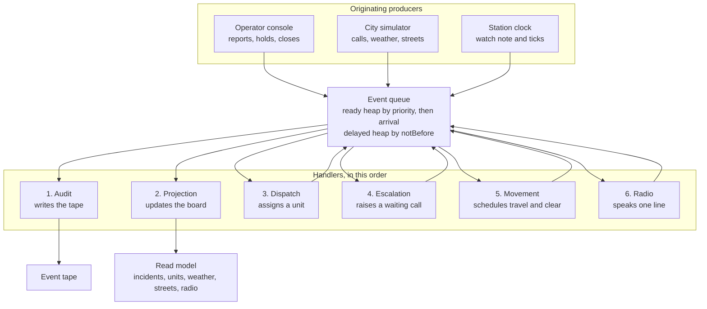

# Architecture

Northline Desk is one process and one queue. The browser tab is that process when you run the board. The `npm run demo` script is that process when you print a trace. There is no message broker and no second service.

Dispatch, escalation, movement, and radio are drawn twice on purpose. They consume events, and they also produce the next ones. Those new events go back through the same queue. They are not applied as hidden side effects.

## Producers

Originating producers decide that something in the city happened.

| Producer | Code | What it emits |
| --- | --- | --- |
| Operator console | `src/lib/edp/producers.ts` (`reportedByOperator`, `updatedByOperator`, `resolvedByOperator`, `unitStatusByOperator`, `obstructionClearedByOperator`, `weatherClearedByOperator`) | Reports and operator actions from the buttons |
| City simulator | `planCityBeat` in the same file | Incidents, weather, and blocked streets while the simulator is armed |
| Station clock | `watchOpened` and `clockTick` | The opening note, then one `clock.tick` each simulated second |

The desk calls the city and the clock from `DeskEngine.advance`. It does not poll them from inside a handler. A handler that needs something later enqueues an event with `notBefore` set in the future. The clock does the waiting.

## Event queue

`EventQueue` in `src/lib/edp/queue.ts` is two binary heaps.

- The **ready heap** orders events by `priority` ascending, then by `sequence` so equal rank is first-in first-out. Priority 1 calls outrank priority 3 calls. A life-safety report outranks a clock tick.
- The **delayed heap** orders events by `notBefore`. `promote(now)` moves due events onto the ready heap before anything is delivered.

`cancel` removes events from either heap. Closing a call uses that to drop a trip that has not started yet.

The queue is in memory. The board also writes a snapshot to `localStorage` under `northline-desk-v1` so a refresh continues the same watch. That snapshot is a copy of the read model, the tape, and both heaps. It is not a second queue.

## Handlers

`createHandlers` in `src/lib/edp/handlers.ts` registers six handlers. `DeskEngine.dispatch` runs the ones that care about the event, in this order, and catches a throw so a bad handler does not stop the rest.

| Order | Handler | Reads | May enqueue |
| --- | --- | --- | --- |
| 1 | Audit | every event | nothing. Appends the event to the tape |
| 2 | Projection | every event | nothing. Folds the event into incidents, units, weather, streets, radio, and notes |
| 3 | Dispatch | new calls, escalations, a unit clearing or returning | `unit.dispatched` or `dispatch.deferred` |
| 4 | Escalation | `clock.tick` | `incident.escalated` when a call has waited with no unit |
| 5 | Movement | dispatch, arrival, close | `unit.enroute`, `unit.onscene`, `incident.resolved`, `unit.cleared` |
| 6 | Radio | assignments, arrivals, closes, escalations, weather, blocks, holds | `radio.transmission` |

Projection runs before any handler that reads the board, so dispatch sees the incident that was just reported. Audit runs first, so the tape still records an event if a later handler throws.

Follow-up events are only enqueued. They are delivered on a later turn of the drain loop, which means they pass through audit and projection too. Radio does not handle `radio.transmission`, so a spoken line cannot create another spoken line.

## How a second passes

`DeskEngine.advance` moves simulated time. For each whole second it crosses:

1. The city simulator may enqueue its events.
2. The station clock enqueues one `clock.tick`.
3. The engine drains the queue: promote anything that is due, deliver the best ready event, repeat until the ready heap is empty or 500 events have been delivered.

Draining inside the second means escalation sees time pass one second at a time. A priority 3 call becomes priority 2 at 20 seconds, not in one jump to priority 1.

The browser calls `tick` about five times a second with the real elapsed time, multiplied by the 1x, 2x, or 4x control. Pause stops `tick`. Filing a report calls `produce` directly, so it still drains while the clock is paused.

## One call, end to end

An operator files a priority 1 medical call in Harbor.

1. The operator console enqueues `incident.reported` for `inc-1`. It is ready immediately, at rank 10.
2. Audit records it. Projection opens the incident. Dispatch chooses Medic 1, because that medic is already in Harbor, and enqueues `unit.dispatched` with an en-route time and an on-scene time.
3. That dispatch event is ready and leaves next. Projection marks Medic 1 dispatched. Movement enqueues `unit.enroute` and `unit.onscene` on the delayed heap. Radio enqueues a transmission.
4. The transmission leaves at once and appears on the radio list. The travel events sit in the timed queue, visible in the architecture column.
5. When simulated time reaches `enrouteAt`, promote moves `unit.enroute` onto the ready heap and the crew is marked en route. The same thing happens for `unit.onscene`.
6. On arrival, movement enqueues `incident.resolved` for the end of the work interval. When that is delivered, movement enqueues `unit.cleared` 2.5 seconds later.
7. When the unit clears, dispatch looks for the oldest highest-priority call that is still waiting.

If Harbor is blocked, the same medical call goes to Medic 2 on Campus. The home obstruction adds enough distance that the farther medic is the better choice. If every suitable unit is held, dispatch enqueues `dispatch.deferred` and the call stays open until a unit returns or escalation raises it.

## Where to read it

| Idea | File |
| --- | --- |
| Event names and payloads | `src/lib/edp/types.ts`, and the catalog in `events.md` |
| Districts, roster, timers, scenarios | `src/lib/edp/constants.ts` |
| Producers | `src/lib/edp/producers.ts` |
| Queue | `src/lib/edp/queue.ts` |
| Handlers and the read model | `src/lib/edp/handlers.ts` |
| Loop, snapshot, public actions | `src/lib/edp/engine.ts` |
| The board that shows all three | `src/components/desk-app.tsx` |

The right-hand column of the running desk is this picture with live counts: producers, the ready and timed queues, and the six handlers.
